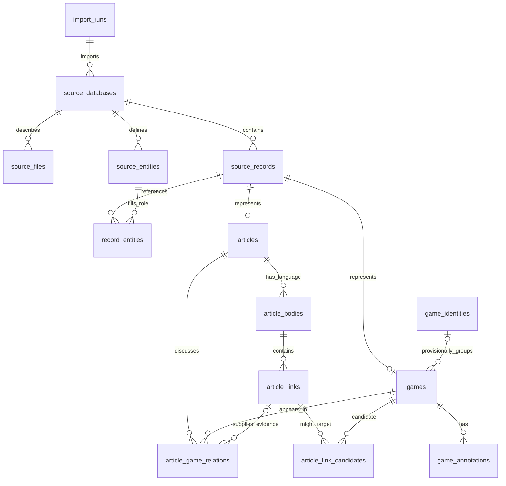

# Opening games and Theory articles: SQLite design

Schema version: **1**. Morphy revision:
`c721bacb53dac9619f268346454d419667497f51`.
DDL: [book-library-schema.sql](book-library-schema.sql).
Extractor: [extract-book-sqlite.py](extract-book-sqlite.py), with the read-only
Morphy bridge [SqliteBookDump.java](SqliteBookDump.java).

The default artifact is `data/tmp/opening-theory.sqlite`. Everything in this
investigation is Git-ignored. This document describes a source-preserving data
foundation for an application; it does not assert that the imported notation,
decoding or inferred relationships have been validated.

## Completed extraction snapshot

The initial execution produced a 4,788,133,888-byte SQLite file from 1,465 source
databases: one main game database and 1,464 Theory databases. It contains:

- 81,404 game occurrences: 40,614 main-collection and 40,790 Theory occurrences.
- 1,484 Theory article/text records, with 11,872 native-language body rows
  (including empty language placeholders).
- 1,860,129 decoded annotations.
- 12,500 resolved explicit article/game links and 42,675 same-source-database
  membership relations. Repeated evidence across languages is retained.
- All 5,170,726 parsed source anchors, including repeated HTML navigation.
  Unresolved/ambiguous links remain stored rather than guessed or discarded.

Three record-level decoder issues are retained with original payloads:
main record 11022 has an unsupported annotation type `0x20`; Theory
`D15_2009 09_Slav Defence.cbh` record 4 and
`D50_2003 01_Queens Gambit Canal Gambit.cbh` record 26 raise move-decoding errors.
These were not repaired or cleaned. Other reader/converter diagnostics are also
stored. Execution totals are in `opening-theory.extract.json`; the reader log is
`opening-theory.extract.log`. Validation status remains **not_run**.

## Scope

Included:

- All Game records from `ddd/OpeningEncyclopaedia/*.2cbh`.
- All Game records and Guiding Text records from databases under `ddd/Theory`.
  A Theory Guiding Text is represented as an article, with every decoded language.
- Native game/entity metadata, move trees, annotations, original binary record
  payloads, source provenance, article hyperlinks, article/game membership, and
  provisional links between occurrences of the same game.

Excluded: AllInOne, Surveys, OpeningTutorials, Autoren, main-book Guiding Texts,
and external multimedia. An article's original HTML may refer to excluded
collections, shop pages or media. Those references remain in the original text;
the extractor does not load the referenced excluded records or assets.

There is no English-only selection, prose cleanup, brace removal, castling-right
correction, null-move conversion, source-specific annotation repair, deduplication,
PGN replay, output comparison, or SQLite integrity-validation pass. All derived
records explicitly remain unvalidated.

## Design principles

**Source occurrences are the primary identities.** A game copied into an article
database remains a separate occurrence from the corresponding main-collection
game. Their annotation trees, language content or metadata can differ. The unique
source key is `(source_database, source_record_id)`; source IDs are 1-based.

**Original payloads and useful decoded data coexist.** Applications can query
names, dates, ECO codes, article languages and annotations without decoding a
ChessBase file. Original bytes remain available when a decoder encounters an
unsupported annotation, an unknown field or damaged data.

**Relationships have explicit evidence.** Colocation within a Theory database,
an actual hyperlink, and equality of decoded game-header fields are different
facts. The schema keeps them separate and does not merge games on the strength
of a provisional identity match.

## Entity relationships



## Tables

### Import and provenance

`import_runs` records timestamps, scope/options, execution status and extraction
totals. `validation_status` is `not_run`. An extraction may finish with decoder
issues; that is distinct from an interrupted execution or a validated library.

`source_databases` records the original path, filename, `cbh`/`2cbh` format,
`main_games`/`theory` role, source-record count, imported/excluded counts,
reader diagnostics and any compatibility actions on disposable copies.

`source_files` inventories the matching native database component files with
original size, modification time and native file-header bytes (known header
sizes for CBH/CBJ/CB2 files, otherwise up to 256 bytes). It is
provenance, not a replacement for an archival copy of every source file.

### Native record envelope

`source_records` contains one included source record. It keeps:

- Native record ID, Game/article type and the source deletion flag. Deleted
  records are retained rather than filtered out.
- Native move/annotation offsets and decoded native header fields as JSON.
- Original core header bytes and, for CBH, original extended-header bytes when
  present in the source CBJ file.
- For CB2, the original 26-byte move/annotation record frames, retaining tags,
  sizes, checksums and spare-allocation counts without comparing checksums.
- Original move and annotation payloads, compressed losslessly with zlib.
- Decoder metadata, errors and per-record library diagnostics.

The CB2 compressed payload BLOBs contain the record **content** returned by Morphy,
and the separate `original_move_framing`/`original_annotation_framing` BLOBs retain
their frames. They do not copy the whole file, free space or spare allocation
area. CBH payloads retain the blob
returned by its native reader. Source-format details therefore remain relevant
when decoding these BLOBs later. Record/file offsets and provenance are retained.
These payloads are authoritative when a derived representation is incomplete.

`decode_status` is `decoded`, `decoded_with_warnings` or `decode_error`; it reports
the extraction operation, not legal chess or semantic correctness. A row with a
decode error still retains whatever metadata and original bytes were readable.

### Entities and game occurrences

`source_entities` stores referenced native players, annotators, tournaments,
sources, teams and game tags, including decoded fields and available original
entity-record bytes. Identities are local to a source database and entity kind.
`record_entities` assigns roles such as `white`, `black`, `annotator`, `source`,
`tournament`, `title`, `whiteTeam` and `blackTeam`. These annotator/player entities
are native game metadata, not the excluded Autoren biography collection.

`games.id` is also the corresponding `source_records.id`. Useful columns expose
names, event/site, date, round/subround, result, ECO, ratings and annotator. Full
native headers and the complete decoded header-field set remain in JSON.

The move representation is:

- `start_fen`: the decoder's original starting position. No castling-right
  correction or legal-position validation is applied.
- `moves_pgn`: Morphy's DTO movetext including the full decoded ordered variation
  tree. Annotations are stored separately, indexed by the DTO's move positions.
- `main_line_ply` and `all_lines_ply`: decoder-derived counts.
- `derived_pgn`: an optional unclean ChessBase round-trip PGN with multilingual
  pre/post directives and extended annotations. This is a convenience export,
  **not an original source file or a validated/import-safe PGN**.
- `dto_metadata_json`: remaining DTO properties, including its FEN value.
- `annotations_decode_status`: distinguishes missing, partial, decoded-but-not-
  validated, and reader-warning cases.

`game_annotations` stores each decoded annotation in original DTO sequence, with
its type, position, language/text where applicable and the complete typed JSON
payload. This includes text, NAGs, drawings, training, evaluations, game quotations
and opaque/raw annotation forms supported by Morphy. Annotation JSON may contain
nested structures; applications must not treat every annotation as prose.

The move index is **PGN order, zero-based**, not main-line ply. `-1` denotes the
game/root position. For `1.e4 c5 (1...c6 2.d4) 2.Nf3`, the move indexes are e4=0,
c5=1, c6=2, d4=3, Nf3=4. Preserve this convention when attaching annotations.

Typed JSON uses `_type` discriminators from the Morphy record/DTO class names.
Enums are strings. Native byte arrays inside JSON are base64 strings; the
dedicated raw-payload columns are binary zlib streams instead. Applications
should dispatch annotation payloads by type and retain unknown properties.

Dates retain their source's partial nature. The searchable `played_date` uses
`YYYY.MM.DD` and `?` for missing parts; the header JSON preserves the structured
year/month/day fields. No plausible date is invented for an unknown component.

### Articles and languages

`articles.id` is also its native record ID in `source_records`. It exposes a
display title, native text format, unknown format field and decoded text-header
metadata. The display title may use English, but that does not select or discard
any article-body language.

`article_bodies` contains one row per native language, with the original decoded
title, content and formatting bytes. Content is kept exactly as returned by
Morphy: HTML remains HTML; older text formats retain their format/formatting.
Empty language bodies are retained. Original binary text content is also in the
source record's compressed move payload for later decoding work.

Language values are native decoder enum names, for example `ENGLISH`/`GERMAN` for
article bodies; annotation DTOs can use IOC-style language codes. They are not
silently translated into a single language-code system.

### Hyperlinks and article/game relationships

`article_links` retains every parsed HTML anchor, including language/body,
ordinal, line/column, original start tag, logical href, label and unmodified
comma-separated CBLink arguments. Original HTML remains available too.
Navigation links have not been stripped from the stored source content.

Link resolution is an extraction index, not validation:

- Numeric `tag_externgame`/`tag_externtext` references use source database and
  original record ID.
- `tag_game` references use their player/event/date/round fields within the
  article's database. A unique matching occurrence produces an explicit link.
  The raw final position hint is retained; its semantics are not validated or
  converted into a guaranteed node index.
- `tag_text` uses the target title in that database.
- `tag_gamelist`/`tag_externgamelist` retain their database-list meaning.
- Ambiguous game matches are stored in `article_link_candidates` rather than
  arbitrarily choosing an occurrence.
- Links to excluded sources or media retain an appropriate resolution status.
  No excluded content is imported to satisfy them.

`article_game_relations` records two direct evidence types:

1. `same_source_database`: the article and game occur in the same Theory database.
   This is a source-membership fact, not an assertion that every paragraph
   discusses every game. Multiple article texts may share that membership.
2. `explicit_game_link`: an anchor uniquely identifies a game occurrence, with
   the link ID, original arguments and optional position hint as evidence.

Several bodies/languages can link to the same game; keep those evidence rows.
An app should deduplicate for display rather than delete source evidence.

`game_identities` provides a provisional grouping key from exact decoded white,
black, event, site, date, round and subround fields. Games with insufficient
identifying information remain ungrouped. This does not compare moves or prove
that two occurrences are interchangeable. Do not collapse their annotations.

The `article_game_occurrences` view expands a direct relation to other occurrences
with that same header identity. Its `occurrence_basis` explicitly distinguishes
`direct` from `same_header_identity_unvalidated`. This connects a Theory article's
model game to its main-collection occurrence while retaining source differences.

## Application query examples

List articles, preferably with an English body:

```sql
SELECT a.id, a.primary_title, a.source_database,
       b.language, b.content
FROM article_catalog a
LEFT JOIN article_bodies b ON b.article_id = a.id AND b.language = 'ENGLISH'
ORDER BY a.source_database, a.source_record_id;
```

Find direct and provisional main-collection occurrences for an article:

```sql
SELECT DISTINCT g.id, g.white, g.black, g.played_date, g.source_role,
       r.occurrence_basis
FROM article_game_occurrences r
JOIN game_catalog g ON g.id = r.occurrence_game_id
WHERE r.article_id = :article_id;
```

Load the selected game's annotated variation tree:

```sql
SELECT start_fen, moves_pgn, annotations_decode_status FROM games WHERE id = :id;
SELECT move_index, annotation_type, language, text, payload_json
FROM game_annotations WHERE game_id = :id ORDER BY sequence;
```

Find articles attached to a main-collection game:

```sql
SELECT DISTINCT a.id, a.primary_title, r.occurrence_basis
FROM article_game_occurrences r
JOIN articles a ON a.id = r.article_id
WHERE r.occurrence_game_id = :game_id;
```

Inspect raw payloads in Python:

```python
import sqlite3, zlib
db = sqlite3.connect('opening-theory.sqlite')
row = db.execute('SELECT raw_moves_zlib, raw_annotations_zlib '
                 'FROM source_records WHERE id=?', (record_id,)).fetchone()
moves_bytes = zlib.decompress(row[0]) if row[0] is not None else None
annotation_bytes = zlib.decompress(row[1]) if row[1] is not None else None
```

## Extraction lifecycle and deferred work

Run from the repository root:

```powershell
python data/tmp/extract-book-sqlite.py
python data/tmp/extract-book-sqlite.py --output data/tmp/another-import.sqlite
python data/tmp/extract-book-sqlite.py --resume
```

For a new import the output must not already exist. `--resume` retains completed
sources and re-extracts an unfinished source, then rebuilds derived relations.
It does not replay or validate the stored games. One long-lived Java process reads sources
and streams records to Python's standard-library SQLite writer. CBH inputs are
copied to disposable directories when compatibility recovery is required;
original sources remain unchanged. Duplicate blob counters, missing optional
extended metadata and omitted unsupported optional indexes are reported as
reader compatibility actions. These do not clean game moves, text or comments.
Original file/header provenance and original available extended-header bytes
remain in SQLite.

Transactions commit periodically and per database. Interrupted extraction leaves
an explicitly interrupted artifact; it is not silently declared complete. The
script emits an execution summary JSON and a reader log beside the SQLite file.

Morphy can report or tolerate some decoder problems. Such diagnostics are kept
per record/database and original bytes remain available. Its built-in file
parsing checks are unavoidable, but the script deliberately runs no separate
validation/replay, PGN round-trip checks, SQLite integrity checks or cleanup.

Future work can add validated identities, legality/annotation coverage checks,
position/FEN indexing, a normalized move-node table, full-text search and clean
PGN derivatives. Keep those as derived layers or schema migrations; do not
overwrite the source-preserving layer. In an app, render article HTML in a
sandboxed reader with scripts disabled, and implement CBLink navigation through
the relationship tables rather than executing the source JavaScript URLs.
