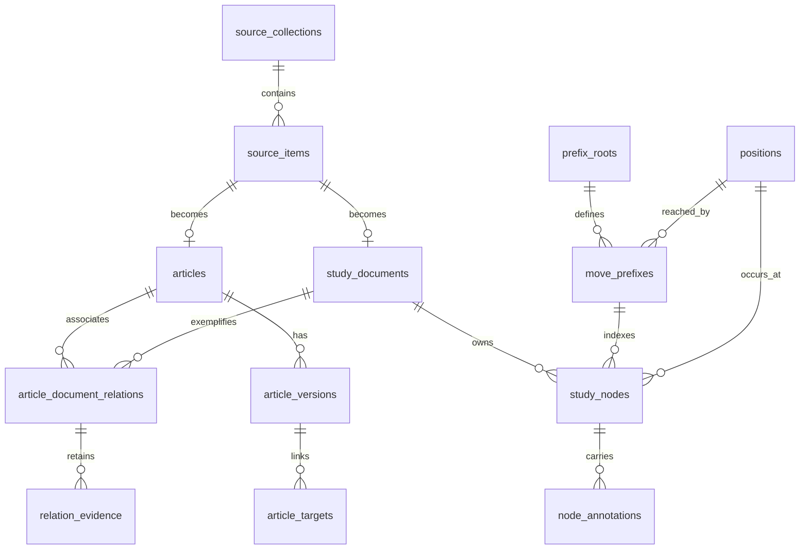

# Opening study: database proposal

2026-10-25 · Logical schema proposal, not executable DDL or a migration.
Companion: [product/system design](HIGH_LEVEL_DESIGN.md).

## 1. Separate archival input from runtime storage

Use three independent stores:

| Store | Purpose | Writes |
| --- | --- | --- |
| Existing `data/tmp/opening-theory.sqlite`, source schema v1 | Archival records, original bytes, all decoded content and relationship evidence | Existing extraction tools only; application conversion reads it without modification. |
| Proposed `opening-library.sqlite3`, opening runtime schema v1 | Validated source trees, article reading content and indexes | Offline builder to a new staging file; desktop read-only. |
| Proposed `opening-user.sqlite3` in user data | Preferences and last exploration/reading location | Explicit desktop session/settings writes; independent schema/version. |

The runtime file has its own `application_id`, schema version, format identifier,
library UUID, content revision and supported algorithm/capability manifest.
Do not reuse the game archive's migration numbering or open this file through
`ChessArchive`. No source BLOB copying into the runtime file is required: keep
record locators, content hashes, conversion diagnostics and supported decoded
content. The archival file remains the full-fidelity source of record. Normal
reading works without that file being present.

Prefer a new complete runtime generation over in-place incremental mutation for
MVP. The builder can resume a staging generation, but only a validated finalized
file is selectable. A later source extraction produces a new runtime revision.
The previous runtime file stays available for rollback.

## 2. Fundamental modeling choices

**Keep source occurrences.** A main-collection game and its Theory copy remain
different study documents, even when headers match. `game_identities` in the
source is provisional; it cannot establish equivalent annotations. Preserve an
optional “possible other edition” reference with its evidence, but do not expand
article membership or collapse counters through that relationship in MVP.

**Keep a source tree and a position identity.** A board position is useful for
transposition search; a node in a specific game tree is needed to interpret
comments, branch order and author intent. Never make annotations properties of
the globally shared position.

**Add a shared move-prefix trie.** Position-only lookup cannot answer “which
source lines followed exactly these moves?” A prefix identity includes a root
and the entire UCI sequence. Two transposing move orders have different prefix
IDs but can share one position ID. This trie is a derived access index; it is
not an editorial opening taxonomy.

**Retain full source depth.** Index every accepted legal move, including author
sidelines and late game moves. The UI only fetches immediate children. An
opening-depth presentation limit may be added later; it must never truncate
playback or silently change what a counter means.

## 3. Counting contract

Let a **document** be one source game occurrence with a completely validated,
nonempty playable tree. Let a **source line** be `(document_id, leaf_node_id)`:
one full root-to-leaf path. A one-line game contributes one source line. Nested
side variations contribute additional leaves; shared prefixes are not counted
as extra lines. This measures the supplied study material, not distinct theory
ideas or training progress.

For a query context `Q`, keep all matching source-node cursors `C(Q)`. A cursor
represents a particular route through one source tree. Compatible lines `L(Q)`
are the union of the descendant leaves below these cursors, after document
filters. Return:

- `gameRecordCount`: distinct document IDs represented by `C(Q)`.
- `sourceLineCount`: number of distinct `(document, leaf)` pairs in `L(Q)`.
- `relatedArticleCount`: distinct included article IDs with a direct relation
  to at least one matching document. Relation evidence is explained separately.
- `endingLineCount`: distinct compatible leaves whose current cursor is already
  terminal. This explains games that end rather than offer another move.

For a child move `m`, advance each cursor to its actual children with UCI `m`.
Do not substitute any globally reachable edge. The child's compatible line set
is a subset of the parent's set, so counters cannot grow during one unchanged
exploration context. A new anchor or filter selection resets this contract.

Examples, before source filtering:

| Document | Full source lines |
| --- | --- |
| A | `e4 c5 Nf3`; `e4 c5 Nc3` |
| B | `e4 e5 Nf3` |

At `e4`: 2 game records, 3 source lines. At `e4 c5`: 1 game record, 2 source
lines. At `e4 c5 Nf3`: 1 game record, 1 source line. If A is copied into another
source, that copy contributes its own game record and lines. Explain this in
the UI; an optional exact-edition display grouping can come later.

Game and article counters across sibling moves are not additive: one document
or article may support several replies. In an ordinary prefix tree, child line
sets plus terminal lines partition the parent line set. Duplicate identical
source branches retain separate leaves, reflecting their separate source
occurrences. In a position-anchored query, repeated occurrences of the anchor
on the same line can make child line sets overlap; report union counts and do
not promise that sibling line counts sum to the parent.

Article counts are association counts, not the number of articles demonstrated
to discuss the exact board position. Same-chapter and explicit-link evidence
both qualify, with different labels. Links repeated in several languages count
once for the article/document relationship.

Apply the same filtered document set to counters, children and result pages.
Source-role and article filters match direct occurrence membership. A metadata
query matches document fields or titles of its directly related articles.
An explicit annotation-language filter selects documents with comments in that
language; merely changing the reading language changes presentation, not counts.
Different filter dimensions combine with AND, values within a dimension with OR.
Source-deleted and quarantined documents do not enter searchable counts.

Coverage accompanies every response. “No indexed continuation” can be definitive
only for the published searchable subset. Report excluded source records and
unsupported annotations separately; a complete index of an incomplete source
must not claim complete encyclopedia coverage.

## 4. Logical schema

Names below describe responsibilities. Final column types, SQL and migration
files are implementation tasks. All internal IDs are SQLite integers; stable
external keys are strings. Foreign keys are enabled, with explicit checks for
valid status enums, nonnegative counts, valid JSON and unique natural keys.



The source-node and prefix hierarchies each have parent links; only source nodes
own annotations. The diagram omits those self-links and build/quality tables
for readability.

### Library, provenance and quality

| Table | Important columns and constraints |
| --- | --- |
| `library_manifest` | Singleton: format, schema version, library UUID, revision, source-manifest hash, build status, builder/parser/annotation/sanitizer versions, hash algorithm, creation time, capability and coverage JSON. Final status must be `ready`. |
| `source_collections` | ID, stable source key, relative path, native format, `main_games/theory` role, display title, extraction provenance. Unique stable source key. |
| `source_items` | ID, stable record key, collection FK, native record ID, type, deleted flag, source-content hash, source decode status, runtime validation status. Unique `(collection_id, native_record_id)`. Includes rejected records for inventory. |
| `build_record_state` | Source item PK/FK, input hash, converter version, state, validated-node/annotation counts and checkpoint. Used for staging/resume, summarized at finalization. |
| `quality_issues` | Item FK or library scope, stage, severity, diagnostic code, source location, bounded detail and disposition. Every exclusion/unsupported transformation has a reason. |

Stable item identity is based on a corpus namespace plus normalized relative
source-database path and native record ID, not an absolute machine path or an
autoincrement ID from a later extraction. Preserve original spelling alongside
normalized path keys. Corpus identity is retained explicitly across builds.
Content hashes identify revisions, not interchangeability. A changed source
layout requires an explicit mapping; do not guess it from similar headers.

### Game documents and navigable trees

| Table | Important columns and constraints |
| --- | --- |
| `study_documents` | ID, unique source-item FK, white/black/event/date/result/ECO/annotator display fields and normalized search fields, full original start FEN, root prefix FK, tree hash, annotation hash, playable/annotation coverage, node/leaf counts. Preserve unknown/partial dates. |
| `positions` | ID, signed 64-bit Polyglot hash, exact normalized four-field key; unique `(hash, exact_key)`. |
| `prefix_roots` | ID, unique normalized root-position FK. Full move counters remain document-local. |
| `move_prefixes` | ID, root FK, nullable parent-prefix FK, depth, UCI move, resulting position FK. One synthetic depth-zero node per root; nonroot unique `(parent_prefix_id, move_uci)`. |
| `study_nodes` | ID, document FK, nullable parent-node FK, original child ordinal, UCI, SAN, relative ply, source PGN-order move index, stable source path, viewer path, prefix FK, position FK, `is_mainline`, DFS leaf interval. One synthetic root per document. |
| `node_annotations` | ID, document/node FKs, original sequence, source type/language, normalized language, placement, normalized payload JSON, support status and original decoded payload JSON. Unique `(document_id, source_sequence)`. |

Enforce root uniqueness with partial unique indexes; SQLite's ordinary UNIQUE
constraint does not make multiple NULL roots unique. Nonroot nodes are unique
on `(document_id, parent_node_id, child_ordinal)`, and all nodes on
`(document_id, source_path)`. Parent nodes must belong to the same document;
use a composite parent FK or an equivalent checked insertion invariant. Prefix
parent depth/root, source-node prefix/position agreement and acyclicity are
verified at build time. A move-prefix ID never substitutes for a source node ID.

The stable source path is the ordered sequence of original child ordinals from
the root, not SAN text or a viewer-generated path. The node reference exposed to
the UI includes stable document key, tree hash and source path. Viewer paths are
versioned derived mappings. Duplicate same-move siblings can share a prefix but
retain different source paths and annotations.

Each document root has source move index `-1`. Other source indexes preserve
Morphy's zero-based **PGN traversal order**, including variations. For
`1.e4 c5 (1...c6 2.d4) 2.Nf3`, indexes are 0, 1, 2, 3, 4 respectively. They are
not mainline ply. A source annotation at index 4 belongs to Nf3, not d4. Build
and validate this mapping before translating annotations or generating viewer
notation. Do not rely on a generic parser that silently skips source tokens.

`TextBefore` remains attached to its move with `placement=before`; `TextAfter`
uses `after`. Root text uses root placement. NAGs/drawings/evaluations have
explicit types and attachment rules. Array evaluations require a separately
verified offset/mapping and score convention; a root-attached array is not one
root evaluation. Retain unknown payloads as unsupported data with a readable
notice, not a fabricated score. Quotations are embedded source material, not
automatically additional top-level searchable game trees.

Store a depth-first leaf interval `[leaf_lo, leaf_hi)` on each accepted source
node. Every terminal node gets one document-local leaf ordinal, and each
ancestor's interval spans all its descendant leaves. Then descendant line count
is `leaf_hi - leaf_lo`. There is no need for a path-by-position-by-leaf posting
table, which would duplicate long prefixes for every variation. Documents with
no playable moves are metadata-only and contribute no searchable lines.

### Articles and controlled relationships

| Table | Important columns and constraints |
| --- | --- |
| `articles` | ID, unique source-item FK, stable key, display title/search key, source ECO/title metadata with extraction method. No inferred global opening root is required. |
| `article_versions` | ID, article FK, source and normalized language, title, sanitized reading-block JSON, plain text, meaningful-body status, source-body hash, sanitizer version. Unique article/source-language pair. |
| `article_targets` | ID, version FK, stable block/anchor key, source link locator, target kind, resolved article/document FK if known, raw position hint, nullable validated node FK, resolution status/evidence. Candidates retained as structured data or a child table. |
| `article_document_relations` | Article/document FKs, evidence kind (`explicit_link` or `same_source`), unique pair/kind; source evidence references retained. Indexed in both directions. |
| `relation_evidence` | Relation FK, source link/body locator and resolution details; retains multilingual evidence without multiplying display membership. |

Article bodies are normalized once offline into safe blocks. Preserve source
locations so links in the reading content map to `article_targets`, even after
navigation removal. A FEN diagram block is accepted only after FEN validation.
Unsupported media retain labels and a status rather than an active asset URL.
Do not copy millions of repeated navigation anchors into the runtime hot path;
their complete evidence remains in the archive. Keep relevant unresolved
main-body links as visible, disabled or candidate-bearing targets.

Do not turn source filenames or prose move snippets into authoritative opening
paths. Article reachability initially comes from direct model-game relations.
Manually curated article-to-position/section associations can be a later layer
with a separate provenance type. An article with no indexed linked example
remains available through a standalone title catalog and can show why its
examples are unavailable.

### Mutable user store

`user_preferences` contains board/display/language settings.
`workspace_resume` contains library UUID/revision, exploration root or anchor,
chosen UCI sequence, filters, selected article/document/node, reading scroll and
orientation. Store stable keys and hashes, not just integer row IDs. On a changed
revision, replay moves and validate selections; discard invalid navigation
targets with an explanation. Preserve settings when the library is missing.

Personal notes, repertoire lines and learned-state tables are deliberately not
defined in MVP. A future note must name a source node/version or a deliberately
chosen global position scope; those have different meanings.

## 5. Position identity and indexes

Reuse `lib/position-hash.mjs`'s versioned `polyglot-standard-v1` contract:
placement, side to move, castling rights and Polyglot's en-passant convention.
Keep halfmove/fullmove counters for playback in the document's FEN, but exclude
them from transposition identity. Positions with different castling rights are
different. Repetition history and the fifty-move rule are not modeled by this
opening-position equality; the source path still retains move history.

Use both the signed SQLite hash and exact four-field key for lookup. Never pass
64-bit hashes through JavaScript Number; use BigInt internally or compute them
in the trusted service from FEN. Do not mix this key with `electron/openings.mjs`
catalogue keys, which use legal-en-passant normalization. Reject unsupported
variants, impossible FEN metadata and illegal moves rather than silently
normalizing them into another position.

Minimum intended indexes:

| Access pattern | Index/constraint |
| --- | --- |
| Resolve position safely | `positions(hash, exact_key)` unique |
| Get next move-prefix | `move_prefixes(parent_prefix_id, move_uci)` unique for nonroots |
| Find documents supporting a prefix | `study_nodes(prefix_id, document_id, leaf_lo, leaf_hi)` |
| Seed a transposition search | `study_nodes(position_id, document_id, id)` |
| Advance actual source cursors | `study_nodes(parent_node_id, move_uci, document_id, id)` |
| Resolve review path | `study_nodes(document_id, source_path)` unique; source index unique where nonroot |
| Read source children/annotations | Parent/child-ordinal index; `node_annotations(node_id, source_sequence)` |
| Filter source and metadata | `source_items(collection_id, validation_status, id)`; selected document ECO/search indexes after measured query plans |
| Article relation lookup | Unique `(article_id, document_id, evidence_kind)` and reverse `(document_id, article_id)` |
| Article title catalog/language | Normalized title index; article/version language indexes |

Start without FTS or a separate global `position_edges` table. A global edge
graph loses route provenance and can introduce unsupported combinations and
cycles. Indexes should support measured queries, not every possible metadata
field. The source-scale storage budget is discussed below.

## 6. Query execution

### Move-order exploration

1. Validate root and UCI sequence. Resolve the normalized root, then walk the
   move-prefix trie by indexed `(parent, move)` lookups. Derive the current board
   by legal replay and check its position against the prefix's position.
2. Select source-node cursors by prefix ID and the common document predicate.
   The same prefix cannot be matched from a different root or shorter route.
3. Count distinct documents; sum descendant-leaf interval lengths. When duplicate
   source branches match the prefix, their same-depth subtrees are disjoint.
4. Advance cursors by their actual child nodes, group by UCI, and compute child
   counts. Count terminal cursors separately. Attach SAN from the legal board.
5. Fetch bounded material pages; resolve distinct related articles by document
   relations. Return deterministic node matches with each game card.

Example query shape (illustration only):

```text
matching_nodes := study_nodes WHERE prefix_id = selected_prefix
                  JOIN filtered_documents
games          := COUNT(DISTINCT document_id)
lines          := SUM(leaf_hi - leaf_lo)
next_moves     := children OF matching_nodes GROUP BY move_uci
articles       := DISTINCT relations.article_id FOR matching document IDs
```

Do not decompress PGN or walk every full source tree per request. At early
prefixes the matching set can still contain tens of thousands of nodes. Cache
bounded common unfiltered/role-filtered responses by library revision, prefix
and filter hash. Add materialized prefix/role counts only if real benchmarks
justify them; counters under arbitrary filters must remain exact.

### Position-anchor exploration

1. Find the exact position, then seed cursors from all matching source nodes,
   including custom-root nodes. Save this anchor and its library revision.
2. Apply any chosen suffix by repeated actual-child joins on UCI; keep source
   node cursors, not just the current board's position ID. One source line can
   support the suffix from more than one occurrence of the anchor.
3. For counts, union overlapping leaf intervals **per document**, then sum their
   lengths. Do the same independently for each child move. Keep the distinct
   cursor nodes for navigation: interval deduplication for counting must not
   discard routes with different continuations.
4. Choose a stable preferred match for a game card: mainline first, then shortest
   source path and original sibling order. Offer other matches explicitly.

For example, a game that repeats the same position twice and then branches must
not count the same descendant leaf twice. Naively summing per-node leaf counts
or counting raw position occurrences would be wrong. Fixtures must cover this.

Worker-local temporary cursor tables are an option when binding a large set of
IDs is expensive. Opaque cursor tokens are scoped to one open library, filter
hash and session; expire/rebuild them after switching libraries. Pagination
must not change which source nodes contribute to counts. Bound request depth,
payload size and result pages; return an explicit limit error rather than
silently truncating a context and returning misleading counters.

## 7. Conversion, validation and publication

1. **Inventory input read-only.** Verify source format/schema, extraction status,
   counts, integrity and FK state. Record source snapshot identity and hash the
   inputs that affect each record. Full-file hashing is a one-time build cost,
   not a startup operation. Do not assume `decoded` means legal or complete.
2. **Create a new staging file.** Refuse source/output aliases, an existing final
   output and unsupported schema versions. Save builder versions and scope.
3. **Parse every tree with source indexing intact.** Replay from the exact source
   root, including nested variations. Check complete token consumption, branch
   order, node counts and the source-index mapping. Validate legal setup roots.
4. **Normalize supported annotations.** Preserve sequence, language and placement.
   Compare text/type counts and payload hashes with source expectations. Unknown
   types remain documented unsupported payloads. Explicitly test arrays, draws
   and root annotations rather than treating everything as PGN comments.
5. **Quarantine invalid trees.** MVP excludes an entire document from playable
   indexes when a move, null-move continuation or root cannot be legally and
   completely mapped. Keep metadata and diagnostic details. No silent pruning,
   castling-right repair or reuse of the independently cleaned PGN export.
   A later repair is a versioned, reviewed derived transformation with evidence.
6. **Build indexes transactionally per document.** Publish tree, annotation map,
   prefix memberships and leaf intervals together in staging. Checkpoint only a
   complete unit. Shared prefix/position rows may be reused; final cleanup removes
   orphaned entries. Record failed units for the resume report.
7. **Normalize articles and relationships.** Extract meaningful bodies, sanitize,
   map controlled links and FEN diagrams, and consolidate display relations while
   retaining evidence. Validate source/link/node targets; raw position hints
   remain untrusted unless a tested interpreter establishes their meaning.
8. **Finalize and verify.** Check SQLite integrity/FKs, tree and interval
   invariants, referential reachability, index query plans and count reconciliation.
   Generate and replay viewer PGN for accepted documents and compare ordered
   legal trees, source-path maps and supported rendered annotations. Final
   coverage must account for every source item and annotation disposition.
9. **Publish a closed artifact and report.** Run statistics collection and any
   compaction before final checks. Checkpoint/close WAL connections; no final file
   depends on an omitted WAL. Rename into the new output path only after checks
   pass, with a sidecar checksum/report. Never replace a loaded file in place.

The three known decoder-error records are mandatory fixtures, but not the only
possible exclusions. An annotation failure may leave moves valid; allow
`playable_complete / annotations_partial` only if the move tree and all retained
annotation locations can be independently verified. A failed move decode cannot
use that status. A finalized file can have declared quarantined records, but
never unfinished processing or unexplained losses.

Resume is valid only for the same source manifest and converter versions. On
incompatibility, create a new generation rather than reuse stale node maps.
Keep builds resumable without introducing live editing or cross-file migration
of the original archival data.

## 8. Scale and performance plan

The observed decoder total is approximately 12 million move nodes before
validation, plus document roots. `study_nodes` will be of that order. The prefix
trie is at most another node per distinct source prefix; actual sharing and
SQLite B-tree/index overhead must be measured. Leaf intervals avoid multiplying
every move by every descendant line.

Even an illustrative 100 bytes per source node is about 1.2 GB before trie,
indexes, annotations and articles. This is arithmetic for planning, not an
estimated file size. The source archive itself is 4,788,133,888 bytes, much of
which is preservation payload and repeated HTML. A new index can still be large;
there is no defensible compression/size claim before building a representative
slice and then the full corpus.

Stream input in bounded batches. Do not load all source trees or millions of
anchors into renderer memory. Use temporary per-document data for replay and
leaf numbering. Store board positions once globally and reconstruct full FENs
from source root plus path for review. Keep large article/annotation payloads
out of covering indexes. Compress cold payloads only after measuring the cost
and preserving bounded, checksum-verified decoding.

Benchmark standard root, common opening prefixes, deep branches, no-hit paths,
custom roots and repeated-position anchors. Include source/article/language
filters, page retrieval and article reading. Compare query results with an
independent small-tree oracle. Record wall time, p50/p95, cold/warm runs, query
plans, CPU, peak memory, disk and per-table/index size on named hardware.

If the proposed response budgets fail, first inspect joins, worker scheduling
and common-prefix caching. Then consider materialized default counts or a
bounded prefix-index depth with actual-source cursor traversal below it. Such
an optimization needs equivalence tests and a versioned manifest; it must not
change the semantic scope or mask an incomplete index.
