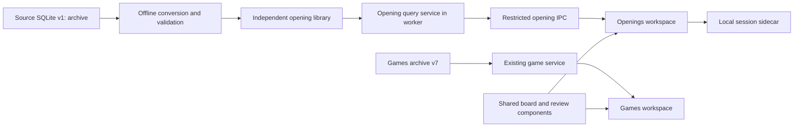

# Opening study: high-level design

2026-10-25 · Proposed MVP · See [database design](DATABASE_PROPOSAL.md) and
[implementation tasks](MVP_TASKS.md).

## 1. Product purpose

Provide an offline opening study library in which the player can play moves,
see which source continuations remain, read the relevant explanations, and open
an annotated example at the matching branch. The useful unit is an explained
line in context, not just an opening name or a frequency table.

A successful first session is: play the beginning of one's opening, choose an
opponent reply, read an article explaining the plans, inspect an annotated
example and its sidelines on the board, then return to the same exploration.
The MVP is a reference and study tool. Counts describe available source
material; they do not describe what the player has already learned.

## 2. What was examined

The investigation documents and complete source DDL were read, along with the
current app's browser, board/review integration, Electron API/database access,
position fingerprint/search implementation, migrations, package configuration
and database/product documentation. SQLite was opened read-only with
`mode=ro` and `PRAGMA query_only=ON` for aggregate queries and representative
trees, annotations, article bodies and links. No legality replay or full database
integrity pass was performed as part of this design.

The following is evidence from the current local artifact, not a validated
runtime-library inventory:

| Observation | Design implication |
| --- | --- |
| Source schema v1; import status `extracted_with_decode_errors`; validation `not_run` | Conversion needs a separate validation and publication gate. |
| 1,465 source databases: one main collection and 1,464 Theory databases | A chapter/source association is useful; it is not itself an opening-position classification. |
| 81,404 game occurrences: 40,614 main, 40,790 Theory | Copies and annotated editions must remain distinguishable. |
| Sum of reported mainline plies 5,984,652; all-line plies 11,959,899; largest reported tree 3,126 plies | Build searchable trees offline; benchmark the whole corpus. These are decoder counts, not validated legal-node counts. |
| 1,484 articles and 11,872 language rows | Article reading belongs in the core workflow. A nonempty HTML field can contain shared navigation rather than translated prose. |
| 1,860,129 annotations, including text before/after, NAGs, arrows, squares, evaluations and quotations | A generic comment string is an inadequate intermediate format. |
| 5,170,726 source anchors; only 12,500 `explicit_game_link` relation rows, alongside 42,675 same-database relations | Strip repeated navigation in a derived reading view; retain evidence and uncertainty. Do not treat all anchors as teaching links. |
| Three record decoder errors and 4,558 records with diagnostics | Extraction success and trustworthy playback are separate states. |
| 25 non-null start FENs differ from the orthodox board/castling prefix; two FENs are missing | Support validated setup roots. This SQL count is not a legality assessment. |

Samples include SQLite `games.id=2` with 317 reported all-line plies, text and drawings
on sidelines, and a root-level evaluation array. Its comment at source move
index 16 explicitly identifies an article's main position: attaching comments
only by ply would lose this context. Article 40615 contains explanatory prose,
game links with position hints, and diagram images with `alt="fen:..."` metadata.
These FENs may allow local replacement diagrams after validation, even where
the original image files are absent. Some sampled link labels show encoding
damage; keep original text and report any proposed repair.

The older `data/tmp/content-audit/findings.md` describes a stage when only two
Theory databases were supplied. Its missing-library totals are historical and
do not describe the current SQLite snapshot. The newer extraction document and
live source-database inventory take precedence.

## 3. Relationship to the existing app

The current application is Electron/React/SQLite, with Chessground through the
Lichess PGN Viewer and chessops for legality. Schema v7 intentionally contains
games rather than standalone articles. The current `ChessArchive` reader accepts
only v7. Its original PGNs remain preserved; favourites and personal analysis
use explicit writes to that archive. Its optional position index includes
mainlines and, when built explicitly, author sidelines.

The existing opening-name hierarchy is a Lichess catalogue classification. It
is not the encyclopedia's article structure or a repertoire tree. Existing
position search returns games reaching a position; it does not compute the
remaining source lines or explain which continuation belongs to which article.
The browser also currently requires an explicit position-search action after
board edits. Opening exploration should update after each completed legal move.

| Existing component | Proposed reuse | Required boundary |
| --- | --- | --- |
| `src/PgnBoard.tsx`, viewer/Chessground integration | Board, move navigation, legal interaction, orientation and resizing patterns | A controlled opening-session adapter; PGN is a generated view of validated source nodes. |
| `src/ReviewMoves.tsx`, `src/pgn.mjs`, NAG descriptions | Readable score, branches and familiar annotation presentation | Verify fidelity of converted before/after comments and typed drawings; do not assume a round trip is lossless. |
| `src/GameReview.tsx` | Review layout and navigation patterns; extract small shared pieces as needed | It currently depends on game archive APIs and personal persistence. Do not mount it unchanged with fabricated v7 IDs. |
| `lib/position-hash.mjs` | Exact-position fingerprint and strict standard-chess FEN contract | Preserve its versioned hash plus exact-key check. |
| `lib/position-mainline.mjs`, builder and search tests | Replay/path verification and coverage patterns | New all-tree importer and opening-specific queries; existing tables do not provide prefix counts or article links. |
| Property filters and search UI | Filter interaction, paging and result cards | Opening-specific fields and counts; no dependency on v7 SQL. |
| Electron context isolation, bounded IPC, engine infrastructure | Desktop shell, security and future optional analysis | Independent opening API and database handle; engine integration can follow MVP. |

Reuse should follow contracts rather than copying the whole review feature or
forcing the new content into `games` in the old database. Keep the current Games
workflow usable while Openings is absent or its library is unavailable.

## 4. Packaging decision

| Option | Benefits | Costs and risks | Recommendation |
| --- | --- | --- | --- |
| New repository and standalone app | Independent release and product identity | Duplicate desktop, board and review maintenance; shared fixes require a package strategy | Revisit if ownership, technology or release cadence diverges. |
| Same repository, separate opening build | Shared code with independent installers | Two build configurations, settings, release pipelines and regression surfaces | Keep feasible through the module boundary; defer the second installer. |
| Same repository/build, separate workspace | Fastest reuse, one installation, easy return to Games | Requires explicit navigation and API isolation to avoid a crowded browser | Recommended MVP. |

Use top-level **Games / Openings** navigation, not an extra encyclopedia filter
inside the games list. Remember each workspace's selected file and session
independently. Opening a library must not replace the Games archive. No library
is bundled by default; loading one is explicit. File type and manifest checks
must distinguish the two formats even if their numeric schema versions coincide.

This recommendation assumes a local, single-user desktop application and the
same developer maintaining both features. It is reversible: opening storage,
queries and UI live behind their own service contract. Do not undertake a full
monorepo/package extraction merely to preserve this future option.

## 5. Exploration semantics

### Follow a move order: default

Start at the standard position, play legal moves on the board or click a row in
the next-move list. Show the chosen SAN breadcrumb and the immediate supported
replies. Rows contain move, remaining source lines, game records and related
articles; expansion is lazy. A collapsed single-reply sequence may be a visual
shortcut later, but every underlying ply remains navigable.

The result set contains source tree paths sharing the entire chosen sequence
from the same root. A selected line retains all legal author variations, not
just the moves played in the game. Therefore a game can support several replies.
After each move the set of compatible paths can only stay equal or shrink.
Filter changes and a new starting position deliberately start a different query.

Use **Game records**, **Source lines**, and **Related articles** as explicit
labels. A source line is a root-to-leaf path in one validated source tree,
including its mainline. Two copies count as two source records/lines in MVP.
Explain this once near the counters and allow filtering Main collection / Theory.
Do not label these figures unique historical games, popularity, win odds, or
studied/trained variations. [Exact rules](DATABASE_PROPOSAL.md#3-counting-contract)
are part of the API contract.

### Find the same position: explicit action

At any position, **Find other move orders** starts a position-anchored search.
FEN input is another way to start this search. It can add material not reachable
through the chosen prefix, including setup-root records. Mark the new context
clearly and offer return to the previous move-order session.

Match every validated source node reaching the exact position. From that anchor,
further moves follow those source continuations, so the anchored set also
narrows. Do not re-run an unrestricted position search after every move: doing
so would unexpectedly reintroduce previously excluded lines. Repeated visits
and transpositions retain multiple source paths but do not multiply counters.
The database proposal specifies the descendant-line union needed here.

### Unsupported or exhausted branches

Permit a legal move absent from the library; show the resulting board and an
empty continuation list with Undo. Distinguish “no indexed continuation” from
“this source line ends here” and from incomplete library coverage. Never invent
a continuation or silently jump to a different move order. Illegal moves do
not advance the session. Handle promotion choices and terminal positions.

## 6. Workspace and reading flow

The main view keeps three areas available:

- **Board and path:** current position, orientation, move breadcrumb, Undo,
  Reset, keyboard navigation and an optional FEN entry.
- **Continuations:** immediate moves with contextual counts; results update on
  a completed legal move. Load deeper branches and result pages on demand.
- **Study material:** tabs for Articles, Game records and Source comments.
  Search by article title, opening name/ECO, player or annotator; filters for
  source role, article and annotation language. Text search filters metadata in
  MVP; annotation/prose full-text search is deferred.

These areas can collapse into tabs in a smaller window. Mouse, board clicks and
keyboard move selection must lead to the same session state. Keep the board
stable while new results load; reject stale responses after rapid navigation.

Articles also have an independent title catalog, so essays without a playable
linked example remain discoverable. An article is related to an exploration
when a matching game occurrence has explicit-link or
same-source membership evidence. Show “Linked example” ahead of “Same chapter”.
This means the article has relevant examples, not that every paragraph discusses
the current position. Opening an article exposes a **Study this article** filter
for its direct model-game records. Deduplicate article cards across language and
link evidence; keep evidence available on demand.

The reader displays cleaned, sanitized explanatory content in the selected
language, retaining headings, lists, emphasis and controlled internal links.
Remove shared navigation in the derived reader, not from the source archive.
If no reliable main-body extraction is possible, show a safe whole-body fallback
with a notice rather than deleting questionable sections. Retain attribution
and source details. Source year is provenance, not evidence that the theory is
current or exhaustive.

Language selection is explicit. Prefer the chosen nonempty explanatory body,
then an indicated fallback. Game comments prefer the chosen language, then
untagged text, then an indicated available language. All comments in the selected
bucket remain ordered. Do not concatenate translations or assume that navigation
text proves an article has a translation. Original language identifiers remain
available in provenance alongside a normalized display mapping.

An article game link opens the exact referenced occurrence. Its raw numeric
position hint is not a trusted ply or node; jump only if its interpretation has
been validated. Otherwise open the game root with a short notice. Ambiguous
links show candidate examples; unavailable content remains visibly unavailable.
Never execute `javascript:CBLink(...)` or infer a target from the visible label.
Validated diagram FENs can produce local boards without loading source image URLs.

Selecting a game record opens a familiar annotated review at the verified
matching node. Allow full nested navigation, NAGs, comments, evaluations, arrows
and squares. Review may show the whole source tree, but highlight the search
match and distinguish source moves outside the current exploration filter.
Back restores the exact board, filters, result page, article scroll and focus.

At an aggregate position, show a list of comments with source game, author,
language and branch context. Choosing one selects that source occurrence and
node for the board's annotations. Do not merge competing evaluations or overlay
all authors' drawings. Keep before-move comments attached to their intended
move, even when presenting them near the preceding board position.

## 7. System boundaries

Keep source conversion offline and outside desktop startup. The desktop opens a
published opening library read-only. Mutable session state lives in a small
separate user-data store; rebuilding a library must not erase personal state.
MVP persists only settings and last exploration/reading location. Resume targets
include library/content identity and are revalidated on load.

Illustrative API responsibilities, not committed method names:

| Operation | Input | Output |
| --- | --- | --- |
| Open/catalog | User-selected existing file | Format, library/revision, coverage and compatible capabilities |
| Explore | Session root/anchor, moves, filters, request revision | Board/path, child moves, counters, coverage and cursor |
| Material page | Exploration cursor, kind, bounded page | Article/game/comment cards with match references |
| Article detail | Stable article key and language | Safe reading blocks, controlled targets and provenance |
| Study detail | Stable occurrence key and node reference | Validated tree/display notation, typed annotations and source identity |
| Resume | Serialized local context | Replayed valid context or explicit safe fallback |

Validate all IDs, paths, FENs, filters and size limits at the main-process
boundary. A worker owns the read-only SQLite connection and expensive queries;
the renderer receives bounded DTOs, not SQL or files. Session cursors bind to
library revision and filters. Transactional reads keep counts and cards from
the same snapshot. Key caches by full request context; cancellation and request
sequence IDs prevent old results replacing a newer board position.

Article source content is untrusted input. Convert it to allowlisted reading
blocks rather than mounting source HTML in the application DOM. Drop scripts,
event handlers, frames, source CSS, network/file URLs and active embeds. Internal
links are identifiers resolved by the host. Unknown content becomes readable
text or an unsupported-content notice. No remote assets load implicitly.

## 8. MVP boundary and release criteria

MVP includes an explicit opening-library build/load path; move-order and
position-anchor exploration; all validated author branches; meaningful counters;
metadata filters; linked article reading; annotated game review at a matching
node; return/resume behavior; provenance and incomplete-coverage notices.

Deferred: repertoire editing, personal opening annotations, spaced repetition,
learned-line tracking, quizzes, engine integration in Openings, cloud accounts,
online statistics, AI explanations, fuzzy search, annotation/prose full-text
search, unique historical-game deduplication, additional excluded collections
and a second installer. The existing Games workspace keeps its current features.

Proposed performance budgets, to be validated rather than claimed: warm
exploration response p95 at most 200 ms, typical cached UI update within 300 ms,
and first readable article/game view within 1 s on a documented local SSD
reference machine. Report root and deep positions separately, cold and warm
behavior, filter combinations, worker/UI responsiveness and library size.
Do not accept a fixture-only benchmark as evidence for the 12-million-node input.

The MVP is ready when a player can complete the opening-to-article-to-game-and-
back journey offline, counters match independently checked fixtures, ambiguous
source information is not presented as certain, and Games regressions pass.
Coverage omissions and unsupported annotation types must have a complete build
report and visible summaries. Packaging, counter terminology and acceptable
partial-content presentation should be reviewed at the early design gate in
[MVP tasks](MVP_TASKS.md), before expensive UI implementation.
